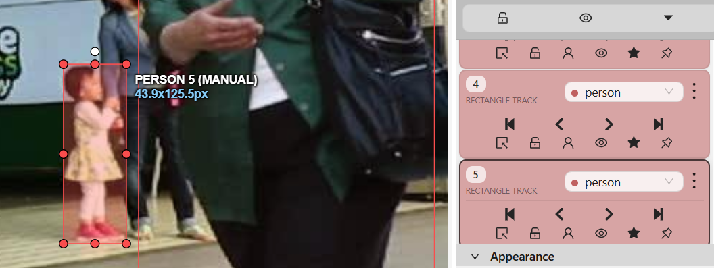
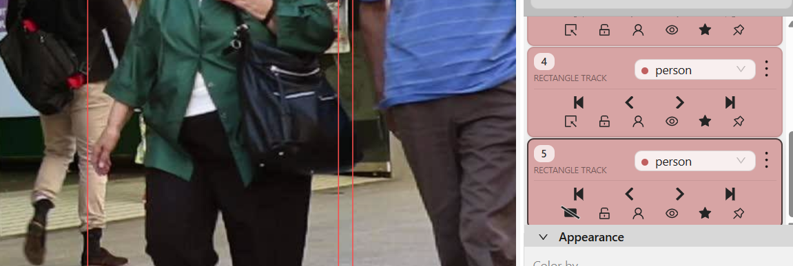
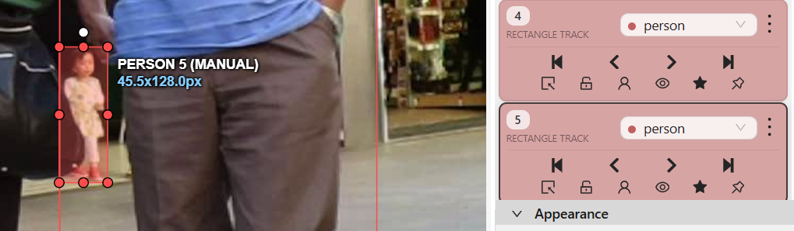

# Báo cáo cá nhân — Nguyễn Thành Tài-202603038

Đoạn video: MOT17-09, 150 frame (frame 1–150), nguồn MOTChallenge, giấy phép CC BY-NC-SA 3.0.

## 0. Thông tin học viên

- Họ tên: Nguyễn Thành Tài
- MSSV: 202603038
- Mã đề (A/B/C): A
- Email: thanhtai5223@gmail.com
- Link repository: https://github.com/NTT19/K5-L2-DAY05-NguyenThanhTai-2A202603038-MOTTracking.git
- Giờ bắt đầu: 16:00 13/11/2026
- Giờ kết thúc: 18:50 13/11/2026

## 1. Xem trước đoạn video (CP0)

Ghi **trước khi vẽ**, mỗi người một dòng.

| Mã | Frame xuất hiện | Frame cuối thấy được | Rẽ / dừng / đổi tốc độ ở frame | Bị che ở frame | Ghi chú |
|---|---|---|---|---|---|
| P1 | 0 | 149 | 10, 20, 100–120 | 30–59 | Bị che một phần từ 30; mất hẳn 40–49; hiện lại nhưng còn bị che đến 59. |
| P2 | 61 | 149 | 110–130 (giảm tốc, đổi hướng nhẹ) | — | Xuất hiện từ mép trái; đi vào vùng quan sát rồi chậm và quay nhẹ về trái. |
| P3 | 0 | 149 | 50–60, 100–120 (tăng tốc) | — | Đi từ phải sang trái, tiến gần camera nên kích thước tăng rõ. |
| P4 | 40 | 149 | 60–70, 120–140 (đổi tốc độ) | — | Xuất hiện ở mép phải, đi sang trái và tiến gần camera. |
| P5 | 0 | 148 | 40–100 (dừng/di chuyển rất chậm) | 110–139 | Đứng gần như tại chỗ; mất hẳn trong 110–139, hiện lại ở 140 và không còn thấy ở 149. |

## 2. Keyframe và thời gian (CP1, CP4)

Số keyframe lấy từ kết quả `src/check_submission.py`.

| Mã | Số keyframe | Keyframe ở frame | Số frame có mặt | Keyframe / 100 frame | Thời gian (phút) | Chỗ khó |
|---|---|---|---|---|---|---|
| P1 | 15 | 0, 10, 20, 30, 50, 60, 70, 80, 90, 100, 110, 120, 130, 140, 149 | 140 | 10,7 | 0,078 (4,7 giây) | Đoạn bị che 30–59, mất hẳn 40–49; chuyển động đổi rõ quanh 100–120. |
| P2 | 10 | 60, 70, 80, 90, 100, 110, 120, 130, 140, 149 | 90 | 11,1 | 0,050 (3,0 giây) | Mới xuất hiện ở 60; giảm tốc và đổi hướng nhẹ khoảng 110–130. |
| P3 | 17 | 0, 10, 20, 30, 40, 50, 60, 70, 80, 90, 100, 110, 120, 130, 137, 140, 149 | 150 | 11,3 | 0,083 (5,0 giây) | Tiến gần camera, kích thước tăng nhanh; đổi tốc độ rõ khoảng 50–60 và 100–120. |
| P4 | 20 | 39, 40, 50, 60, 70, 80, 89, 90, 99, 100, 109, 110, 119, 120, 129, 130, 137, 139, 140, 149 | 111 | 18,0 | 0,062 (3,7 giây) | Xuất hiện ở mép phải tại 39, sau đó đi sang trái và tiến gần camera; kích thước/tốc độ thay đổi nhiều. |
| P5 | 11 | 0, 10, 20, 30, 40, 50, 70, 80, 90, 100, 140 | 119 | 9,2 | 0,066 (4,0 giây) | Dừng hoặc di chuyển rất chậm khoảng 40–100; mất hẳn 110–139, hiện lại ở 140. |
| **Tổng** | **73** | — | **610** | **12,0** | **0,339 (20,3 giây)** | — |

Keyframe / 100 frame của cả bài = tổng keyframe ÷ tổng số frame có mặt × 100 = 73 ÷ 610 × 100 = **12,0**.

Bài làm tôi đặt keyframe nhiều nhất ở **P4** với 20 keyframe. P4 xuất hiện từ frame 39 ở mép phải, đi sang trái và tiến gần camera nên kích thước box tăng mạnh; chuyển động và tốc độ thay đổi nhiều, cần đặt keyframe dày hơn để tránh box bị trôi.

...

## 3. Đoạn bị che (CP2)

Người bị che: `P5` 

| Mốc | Frame |
|---|---:|
| Bắt đầu bị che một phần (bật `occluded`) | Không có mốc riêng trong ảnh/track xuất |
| Mất hẳn (bật `outside`) | 110 |
| Hiện lại (tắt `outside`) | 140 |
| Thấy rõ trở lại (tắt `occluded`) | 140 (P5 không bật `occluded`) |

- Thời gian khuất hẳn: **30 frame = 1,00 giây** (frame 110–139, ở 30 fps).
- Quyết định: **giữ cùng ID P5**.
- Lý do (trả lời 3 câu: khuất bao lâu so với 60 frame, ngoại hình có khớp, chỗ hiện lại có đúng hướng và tốc độ):

P5 chỉ khuất hẳn 30 frame (1,00 giây), ngắn hơn ngưỡng 60 frame (2 giây). Ngoại hình và vị trí của P5 khớp với người trong ảnh trước khi bị che. Khi hiện lại ở frame 140, P5 vẫn ở đúng vị trí, hướng di chuyển và tốc độ nên giữ cùng ID P5.

...

Ảnh chụp màn hình:





## 4. Tự review ID (CP3)

Lượt 1 theo người (đi ngược từ frame 149 về 0 trên CVAT), lượt 2 theo cảnh (nhảy 10 frame). Ít nhất 3 dòng; không có lỗi thì ghi một dòng "đã kiểm hai lượt, không lỗi".

Loại lỗi dùng đúng một trong 7 mã: `id_switch`, `fragmentation`, `lost`, `merge`, `false_track`, `drift`, `flag`.

| Frame | Mã người | Loại lỗi | Mô tả một câu | Phát hiện ở lượt | Đã sửa? |
|---:|---|---|---|---|---|
| 109 | P5 | `flag` | P5 vẫn còn ở vùng giao với P3 trước khi bị che; sang frame 110 track chuyển sang `outside` nhưng chưa bật `occluded` ở mốc chuyển tiếp. | Lượt 2 (theo cảnh) | Chưa sửa |
| 110 | P5 | `flag` | Đây là mốc P5 mất hẳn; `outside` được bật đúng, nhưng chuỗi trạng thái che khuất trước mốc này chưa được ghi đầy đủ. | Lượt 2 (theo cảnh) | Chưa sửa |
| 140 | P5 | `flag` | P5 hiện lại bằng đúng ID cũ sau đoạn `outside`; khi kiểm tra lại, phần bật/tắt `occluded` của cùng đoạn che vẫn còn thiếu. | Lượt 1 và lượt 2 | Chưa sửa |

Ba dòng trên là ba mốc của cùng một lỗi cờ `flag`, không tính thành ba lỗi độc lập.

Tổng hợp số lỗi theo loại:

| `id_switch` | `fragmentation` | `lost` | `merge` | `false_track` | `drift` | `flag` |
|---:|---:|---:|---:|---:|---:|---:|
| 0 | 0 | 0 | 0 | 0 | 0 | 1 |

Lỗi nào chỉ lượt 2 (theo cảnh) mới thấy, lượt 1 (theo người) không thấy? Vì sao?

Lỗi `flag` của P5 chỉ được nhận ra rõ ở lượt 2 (theo cảnh), vì khi nhảy qua các mốc của toàn cảnh mới thấy quan hệ che giữa P5 và P3 cùng lúc với việc chuyển sang `outside`. Lượt 1 theo người vẫn xác nhận P5 hiện lại bằng đúng ID cũ, nên không có bằng chứng cho `id_switch`, `fragmentation`, `lost`, `merge` hoặc `false_track`.

## 5. File xuất và kết quả tự kiểm (CP4)

| Kiểm tra | Kết quả |
|---|---|
| Tên file MOT 1.1 | `NguyenThanhTai_mot.zip` |
| Tên file CVAT for video 1.1 | `NguyenThanhTai_cvat_video.zip` |
| Số track ID khác nhau trong `gt/gt.txt` (phải là 5) | **5 — đúng** |
| Frame `outside` không có dòng trong `gt.txt` (đúng / sai) | **Đúng** |
| Job đã completed trên CVAT máy cá nhân | **Có — completed** |

Dán phần tóm tắt in ra từ `src/check_submission.py`:

```text
Số frame in theo CVAT (bắt đầu từ 0). Trong gt.txt, frame_id = frame CVAT + 1.

=== File MOT 1.1: NguyenThanhTai_mot.zip ===
  Số track ID: 5   |   Tổng số box: 610
  [OK]        Đúng 5 track ID.

  Track | Frame có mặt | Số frame | Đoạn vắng (outside)
      1 |   0–149      |      140 | 40–49
      2 |   0–149      |      150 | -
      3 |   0–148      |      119 | 110–139
      4 |  39–149      |      111 | -
      5 |  60–149      |       90 | -


=== File CVAT for video 1.1: NguyenThanhTai_cvat_video.zip ===

  Track | Nhãn   | Frame thấy | Keyframe | KF/100 frame | Frame occluded | Lần bật outside
      0 | person |        140 |       15 |         10.7 |             20 |               1
              Track 0: keyframe ở frame [0, 10, 20, 30, 50, 60, 70, 80, 90, 100, 110, 120, 130, 140, 149]
      1 | person |         90 |       10 |         11.1 |              0 |               0
              Track 1: keyframe ở frame [60, 70, 80, 90, 100, 110, 120, 130, 140, 149]
      2 | person |        150 |       17 |         11.3 |              0 |               0
              Track 2: keyframe ở frame [0, 10, 20, 30, 40, 50, 60, 70, 80, 90, 100, 110, 120, 130, 137, 140, 149]
      3 | person |        111 |       20 |         18.0 |              0 |               0
              Track 3: keyframe ở frame [39, 40, 50, 60, 70, 80, 89, 90, 99, 100, 109, 110, 119, 120, 129, 130, 137, 139, 140, 149]
      4 | person |        119 |       11 |          9.2 |              0 |               2
              Track 4: keyframe ở frame [0, 10, 20, 30, 40, 50, 70, 80, 90, 100, 140]

  Tổng: 73 keyframe / 610 frame có mặt = 12.0 keyframe / 100 frame
  [OK]        Đọc được 5 track từ annotations.xml.

=== Tóm tắt ===
  Lỗi: 0   |   Cảnh báo: 0
  Đạt. Dán phần tóm tắt này vào báo cáo mục 5.
```

## 6. Ba câu kết

1. Nếu được gán lại, bạn sẽ đặt keyframe khác ở đâu? Vì sao?

    Nếu được gán lại, em sẽ bổ sung keyframe cho P4 trong khoảng frame 119–140 và cho P5 ở các frame gần 110 và 140. Vì P4 đang tiến gần camera nên kích thước và vị trí bounding box thay đổi khá nhanh. Nếu đặt keyframe quá xa nhau, quá trình nội suy dễ khiến box bị lệch khỏi người. Còn với P5, em muốn đặt keyframe gần thời điểm bắt đầu bị khuất và khi xuất hiện trở lại để đảm bảo track được chính xác hơn.

2. Có chỗ nào bạn không chắc "cùng ID hay ID mới"? Bạn đã quyết định và ghi chú thế nào?

   Trường hợp khiến em phân vân nhất là P5 khi xuất hiện trở lại ở frame 140, sau khi bị khuất hoàn toàn từ frame 110–139. Sau khi xem xét, em quyết định giữ nguyên ID P5 vì thời gian bị khuất chỉ khoảng 30 frame, chưa vượt quá ngưỡng 60 frame. Ngoài ra, ngoại hình, vị trí và hướng di chuyển của người này vẫn khá khớp với trước khi bị khuất. Vì vậy, em ghi nhận đây là cùng một người và tiếp tục track cũ thay vì tạo ID mới.

3. Một lỗi ID trong job của bạn (nếu không còn sót, chọn lỗi đã sửa) có thể làm xe tự lái dự đoán sai chuyển động của người đó như thế nào? Lỗi đó ảnh hưởng MOTA hay IDF1 nhiều hơn?

   Nếu P5 bị gán ID mới sau khi xuất hiện trở lại, hệ thống có thể nhầm là một người khác, làm gián đoạn lịch sử vị trí và vận tốc. Điều này có thể khiến xe tự lái dự đoán sai hướng di chuyển và phản ứng không kịp thời.Theo em, lỗi này ảnh hưởng đến IDF1 nhiều hơn MOTA, vì IDF1 chú trọng tính liên tục của danh tính, còn MOTA chủ yếu đánh giá lỗi phát hiện và chuyển đổi ID.
